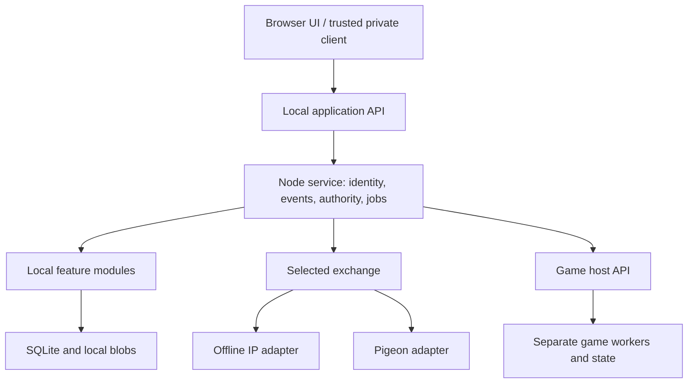

# BBSBOX — Technical proposal and modular delivery plan

| Document control | Value |
| --- | --- |
| Document ID / version | BBSBOX-T2-001 / **0.1.0** |
| Date / scope baseline | 2026-10-25 / Tier 1 **0.4.0** |
| Status | **Proposal for review — no technology, license or optional feature selected by this document** |
| Authority | Implements and refines the Tier 1 scope; cannot override it |
| Implementation | Documentation only; no code or acceptance results claimed |
| Owner | Michael; approval may be delegated explicitly |

## 1. Recommendation

Build a small local application with a transport-independent signed-event core, a responsive locally served interface, and clear feature ownership. Make the first node useful on its own, with maintenance/recovery included. Resolve offline client security and asynchronous group-encryption feasibility early; then connect communities through selected IP links and Pigeons. Add portable game state and validate the whole system in a neighborhood pilot. Optional community services follow as independently approved modules.

The preferred starting stack is **Rust + Axum/Tokio, SQLite + rusqlite, and a static SvelteKit/TypeScript interface**. Evaluate **deterministic CBOR/COSE/Ed25519** for signed records and **MLS/OpenMLS** for private groups. These are recommendations with alternatives and decision gates in [DECISIONS](docs/development/DECISIONS.md), not a claim that the technology has already passed our offline/mobile requirements.

The hard requirements come from [the master spec](BBSBOX_MASTER_SPEC.md). Its R/P/D/N labels are preserved. Optional features remain optional even when this proposal gives them a concrete implementation approach.

## 2. How this becomes a real roadmap without a giant context requirement

This overview is for architecture review. Normal development uses the [development index](docs/development/README.md) to select a single module, then reads [START_HERE](docs/development/START_HERE.md), that module's brief and its one or two shared contracts. Each brief restates its relevant scope, names prerequisites and owned data, proposes technology, gives sequential work slices and defines completion evidence.

| Artifact | Responsibility | When to read |
| --- | --- | --- |
| Tier 1 master | Product mission, scope status, boundaries and acceptance IDs | Product/scope decisions; targeted sections when needed |
| This proposal | System shape and delivery rationale | Architecture/roadmap review |
| Development index | Sequence, dependencies, gates and module links | Choosing the next work unit |
| START_HERE | Compact rules and task/handoff format | Each implementation task |
| One module brief | Bounded outcome, ownership, decisions, slices and evidence | Work on that module |
| Listed shared contracts | Only interfaces that module consumes | Work touching those interfaces |
| Decision register / future ADRs | Alternatives and approved technical choices | Only relevant decision rows |
| Coverage map | Every R/P/D/N/AC mapped to ownership or disposition | Scope/coverage review |
| Work ledger | Actual progress, evidence and remaining work | Start and finish of a task |

Keep mandatory design reading under roughly 2,500 words for a normal module task. Split a growing brief into smaller slices when it exceeds that purpose; do not solve growth by requiring every worker to reread the full roadmap. Module IDs remain stable, even if delivery order changes.

## 3. Proposed system shape

Deploy one node service, not separate network services for every feature. Internal modules have explicit APIs, owned tables and migrations. This keeps operation small while making development sectional. Optional modules are initially first-party code enabled by local configuration. Games run through a process boundary because their execution/lifecycle is separate from the core. A general third-party plugin platform is not required to deliver these features.

The same event validator and reducers process local authored events, mesh imports and Pigeon contents. Transport changes how bytes arrive, not what gives an action authority. File libraries stay outside automatic replication. Local clans/cohorts remain local even when a participating game exports a character.

## 4. Core necessities and technology choices

| Area | Proposed choice | Why / boundary | Decision |
| --- | --- | --- | --- |
| Appliance | Debian stable, systemd, prepared local release bundles and explicit local-only network rules | Predictable install/restart; infrastructure never fetches online resources | T01/T14 |
| Service | Rust/Axum/Tokio modular application | Share protocol/validation code with a lightweight courier; avoid a separate service per feature | T01 |
| Persistence | SQLite WAL, explicit SQL migrations, bounded writer, durable jobs and local blobs | Atomic event/receipt/credit updates and simple backups | T02 |
| UI | Static SvelteKit/TypeScript, local assets, semantic HTML, CSS theme tokens | Phone/desktop support with vibrant-on-black default and SysOp customization | T03 |
| Identity | Separate person root/device credentials, local accounts, node/forum/courier authorities | Username/login convenience does not determine portable identity or forum control | T08 |
| Signed records | Deterministic CBOR, COSE/Ed25519, SHA-256; per-device streams and explicit dependencies | Clock-independent authorization/order and repeatable conformance fixtures | T04/T05 |
| Private groups | Evaluate MLS/OpenMLS and trusted client distribution | Client-only decryption; offline governance/epoch behavior must be proven | T06/T07 |
| Exchange | Authenticated selected IP peers; resumable chunks and simple range/gap inventories | One importer for mesh/Pigeons; more sophisticated routing remains deferred | T04/T05 |
| Games | Local assets, separate workers, scoped HTTP/WebSocket interface and per-game Passport adapters | Game-specific rules/versions and GM acceptance remain authoritative | T10 |
| Lump Drops | Transactional receiver-local credit ledger and explicit delivering-user attribution | One qualifying delivery, one credit; privacy independent of recording | T11 |
| Licensing | Evaluate reciprocal licenses, with explicit owner decision | Proposal names candidates; no LICENSE or user-content license is created | T12 |

Exact library versions must be selected from maintained releases and pinned in lockfiles when implementation begins. Framework availability alone is insufficient evidence for deployment fit. Primary documentation and candidate-specific limitations are linked in the decision register.

## 5. State and ownership rules

**Data that moves:** signed selected messages, forum governance evidence, encrypted payloads, eligible feed/event records, transfer records and receipts. **Data that stays local by default:** sessions, private profile settings, local group membership, local files, local host suppression and peer-policy choices. Some public profiles or game records may reference local groups; that does not replicate or enroll the group itself. Publicness and federation are separate decisions.

Immutable signed events coexist with ordinary transactional tables. Settings, sessions and job claims do not need to become globally federated events. Feature modules own their reducers, relevance predicates and access rules. Cross-module transactions use core service interfaces; games and optional integrations do not write core tables directly.

Shared contracts are kept small:

- [C01](docs/development/contracts/C01-storage-runtime.md): storage, jobs, migrations and module lifecycle.
- [C02](docs/development/contracts/C02-identity-events.md): identity, authority, events and integration results.
- [C03](docs/development/contracts/C03-exchange-delivery.md): exchange, delivery attribution and Lump Drop accounting.
- [C04](docs/development/contracts/C04-games.md): game sessions, profile/group integration, Passport import/export and rewards.
- [C05](docs/development/contracts/C05-private-content.md): privacy surfaces, encrypted client boundaries and complaint access.

These contracts are draft interface proposals. M00–M04 resolve their foundational choices and produce normative schemas/fixtures before compatible implementations depend on them.

## 6. Two early decisions with broad consequences

### 6.1 Offline browser access and independent client trust

An ordinary LAN page, a browser secure context and a client whose code a host cannot replace are different capabilities. Prototype local addresses, HTTPS enrollment, WebCrypto/storage behavior, and fresh installation on actual supported phones/desktops. Evaluate a signed bundled client with a shared UI/crypto implementation where required; Tauri is a wrapper candidate, not a decision that every user must install an app.

Keep ordinary browser access as the primary modern interface. Do not declare host-blind encrypted forums complete until the exact private-client distribution path is demonstrated. If a candidate cannot meet the agreed device/access scope, record the failed evidence and propose a revised client approach; do not silently narrow the product to desktop users or rely on a service-worker cache as independent trust.

### 6.2 Asynchronous encrypted-group behavior

MLS is the preferred established protocol to investigate, but it must be exercised with prolonged disconnection, delayed old-epoch messages, competing governance commits and removed members on stale nodes. The candidate governance design serializes membership changes through authorized owners/delegates while letting ordinary disconnected writers continue under their known state. Retention and rejoin behavior need explicit decisions and evidence. This is not a promise of immediate revocation everywhere.

The host also needs enough authenticated outer information to route, moderate by reference and recognize newly accepted relevant encrypted events for Lump Drops without reading plaintext. That admission contract is part of the encryption gate, not a detail to leave until credit accounting.

## 7. Delivery roadmap and gates

| Gate | Outcome | Main modules | Exit focus |
| --- | --- | --- | --- |
| G0 | Feasible foundations and bounded decisions | M00 | Real device/client, crypto and hardware evidence; recorded chosen prototype scope |
| G1 | Useful standalone alpha | M01–M12 | Accounts/boards/mail/files, people/groups, chosen posts/events, local multiplayer, customization and restore; encrypted forums not advertised yet |
| G2 | Encrypted local community | M13–M14 | Client trust, key behavior, exact complaint targets and role-correct suppression/review |
| G3 | Disconnected communities | M15–M17 | Selected exchange, lightweight Pigeon, correct Lump Drops and independent trust decisions |
| G4 | Portable play and neighborhood pilot | M18–M19 | Supported character transfer, real offline mesh, resident/host trials and all applicable baseline acceptance evidence |
| G5 | Individually approved expansion | O01–O12 | One optional module/slice at a time, with its own approval and acceptance |

These are capability gates, not dates. Different modules can be investigated early, but production claims wait for prerequisite evidence. The [index](docs/development/README.md) gives a valid default order; dependencies, not numeric labels alone, govern readiness.

The default first execution task is **M00 slice A: one reference computer/router, phone and desktop, a fully local page, and a signed-event round trip**. It produces observations and decisions rather than scaffolding every planned feature.

## 8. Optional and deferred features remain visible

Every proposed community feature has an independent brief: utilities/search/chat, encrypted Post Office, Neighborhood Exchange, newspaper, wiki, Meshcasts, Mesh Atlas, dedicated relay, guest/kiosk access, cross-node/signature-dungeon game experiments, business rewards, and recognition/profile additions. Each names a concrete first slice and prevents blanket promotion of its source P IDs.

All D01–D07 ideas have an explicit revisit condition and likely owning module in [COVERAGE](docs/development/COVERAGE.md). No deferred work is placed on the critical path. This includes temporary event nodes, creative souvenirs, larger shared worlds, legacy doors, Merkle optimization, attestation/advanced recovery, and richer radio/routing integrations.

## 9. Validation and scope control

Build a small reusable fixture corpus for signatures, authority, dependency gaps, revisions, mixed versions and retries. Add feature fixtures where behavior is consequential: privacy, counters, importing characters, moderation and recovery. Use browser interaction checks for real user flows and isolated network captures for offline claims. Keep performance targets provisional until measured on named hardware.

G4 combines three demonstrations from the Mastodon lessons: a local gathering; disconnected exchange with moderation/credit; and node/identity/game continuity. Include residents and hosts who do not contribute code. Findings become bounded follow-up tasks or new proposals, not immediate scope additions.

A module is complete only when its owned slices, actual dependencies, relevant acceptance checks, migration/restore impact and operator/user explanation are demonstrated. Later consumers own the real integration of earlier provider interfaces; an earlier module completes its local contract fixtures without pretending that future integration has passed. Full cross-module evidence is required at the corresponding gate. Record the evidence in the work ledger. A single passing demo does not imply all R/P capabilities are shipped. Optional AC16 is exercised only when business rewards are approved and built.

## 10. Proposal decisions requested over time

Review T01–T05/T14 with the first foundation evidence, T06–T08 before encrypted release/continuity claims, T09–T11 before their corresponding feature contracts freeze, T12 before licensed release distribution, and T13 before shared trust/moderation behavior is released. These decisions can be made incrementally; there is no need to approve every optional feature to start M00.

The authorizing request was to prepare this proposal and integrate actionable lessons. No acceptance is inferred from its publication. When a choice is made, add the ADR, update the affected contract/module and record the source decision in the same repository change.
