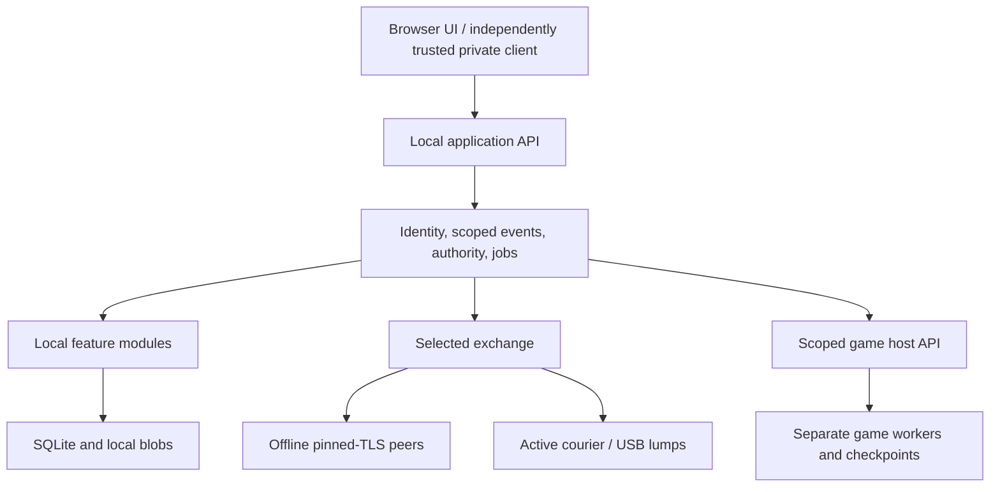

# Historical technical plan v1.0.0

Historical archive — not canon. The plan below records the U19 baseline; its present-tense instructions and authority claims describe that historical edition. Use the [current roadmap](../development/README.md), its live decisions/contracts and current user instructions.

# BBSBOX — Locked technical plan and modular delivery roadmap

| Document control | Value |
| --- | --- |
| ID / version | BBSBOX-T2-001 / **1.0.0** |
| Date / product baseline | 2026-10-25 / Tier 1 **0.5.0** |
| Status | **Accepted for implementation/testing; roadmap locked under U19** |
| Implementation | Unstarted; design review and document checks only |
| Authority | Michael's best-judgment delegation; ADR-0001 records selections |

The filename preserves links from the earlier proposal. This edition selects the defaults, incorporates the senior review and locks a logical execution order. It does not claim that unbuilt software has passed verification.

## 1. Selected architecture

Use a modular Rust/Axum/Tokio node service on Debian stable, SQLite WAL/rusqlite with explicit migrations and transactional jobs, local file blobs, and a static SvelteKit/TypeScript interface. Assets, identity, certificates, updates and recovery remain locally supplied. Games run in separate workers with scoped APIs and owned state. Feature modules are initially first-party components enabled by configuration; a general third-party plugin system is not on the critical path.

Use deterministic CBOR/COSE_Sign1/Ed25519 and SHA-256 IDs. Signing chains are scoped by device AND resource/audience, so local/private content is never a required predecessor of unrelated shared content. Reconciliation handles valid missing history, dependencies, forks and retries without using wall-clock time as authority. Content/control projections converge under equal history/policy; local delivery/credit history is deliberately separate.

MLS/OpenMLS and a Tauri independently signed private client are the selected test implementation for encrypted groups. Browser access remains the ordinary primary interface. Offline mobile installation, secure enrollment, client-code trust, old epochs and concurrent governance must pass real tests before encrypted release. Failed evidence triggers a bounded ADR correction; it does not authorize silently weakening privacy or abandoning modern-device access.

## 2. What the lock approves

P01–P24, T01–T14 and the named M00–M19/O01–O12 scopes are accepted. Operator/user activation of optional services remains optional. D01–D07 stay deferred, and vague unnamed future extras are not accepted by implication. Every module now resolves its listed choices in a short “Locked defaults and verification” section.

Selected product details include a username/link directory baseline; private-by-default optional profile fields; explicit following and distinct confirmed friendships; calendar/RSVP/local reminders; invitation-based local clans/cohorts; active and USB courier workflows; receiver-local Lump Drops; copy/import game branches with owner proof and configured GM approval; manual business codes and reverse coupons; manual discretionary drop rewards; opt-in achievements/progress and local group activity panels.

Software/tools/examples use **AGPL-3.0-or-later**; project-authored design/protocol prose uses **CC-BY-SA-4.0**. See LICENSE.md. Third-party and user-authored material retains its own terms. This license selection is adopted; the word “test” describes technical validation, not a revocable license grant.

## 3. Bounded development context

Use [the index](../development/README.md) to choose a slice. Read [START_HERE](../development/START_HERE.md), the module brief, its listed contracts and only relevant decision rows. Do not load the entire master/roadmap for ordinary implementation. The coverage map and review are lookup documents.

| Contract | Responsibility |
| --- | --- |
| [C01](../development/contracts/C01-storage-runtime.md) | Storage/jobs, migrations, coordinated core/game backup and recovery limits |
| [C02](../development/contracts/C02-identity-events.md) | Identity, scoped signed streams, authority and integration outcomes |
| [C03](../development/contracts/C03-exchange-delivery.md) | Selected transport, valid provenance, receipt states and receiver-local credit |
| [C04](../development/contracts/C04-games.md) | Worker/game sessions, owner-authorized Passport import, groups/profiles and reward deduplication |
| [C05](../development/contracts/C05-private-content.md) | Privacy fields, client trust, outer encrypted admission and complaint access |

Keep a module task's mandatory design packet near 2,500 words. Exact schema/code context grows only with the task that needs it. Contracts are selected design boundaries; normative byte-level fixtures are an implementation output before protocol v1, not invented by a documentation approval.

## 4. Core-first roadmap

| Gate | Modules | Deliverable |
| --- | --- | --- |
| G0-local | M00 core experiments | Offline device access, storage and signed-event evidence; explicit private-client/crypto blockers if any |
| G1 | M01–M12; run M12 immediately after M04 | Useful standalone node with restore, boards/mail/files, people/groups, chosen posts/events, themes and local multiplayer |
| G2 | M13–M14 | Verified private clients/forums, encrypted friend-audience adapter and target-linked complaints/suppression |
| G3 | M15–M17 | Selected offline exchange, active/USB Pigeons, credit and local trust decisions |
| G4 | M18–M19 | Owner-authorized game portability and independently operated real neighborhood pilot |
| G5 | O01–O12 | Approved utilities, correspondence, local services, publishing, atlas/relay/kiosk, game experiments and rewards |

The [index](../development/README.md) and [graph](../development/roadmap.json) provide exact dependencies and order. G4 is the core pilot; it does not pretend G5 is implemented. Each expansion has AC23–AC34, and O11 additionally requires AC16. No release dates or hardware capacities are inferred from scope approval.

M00's private-client tests may continue while independent local work proceeds after G0-local. Conversely, a successful local browser experiment does not pass G2. Every completed module records actual prerequisite/integration evidence; mocks establish only a local interface fixture.

## 5. Senior review corrections

The [review record](review-2026-10-25.md) accounts for every module. Corrections are reflected in the working contracts and briefs:

- Scope signing streams to prevent private/local predecessor leaks or sync deadlock.
- Include separate game databases in consistent checkpointed backups; record post-snapshot data loss honestly.
- Reserve courier provenance only after basic authenticated admission; distinguish staged, integrated and credited events.
- Require destination-bound character-owner proof in addition to origin signature and GM approval.
- Keep core cookies/private keys outside game origins; distinguish cookie login from installed-client pairing.
- Apply host suppression to ordinary sync/export/search paths while keeping case-specific authorized moderator retrieval.
- Give future consumers their integration work; repair M09/M11/M18 completion cycles and missing mail/transport dependencies.
- Move recovery early and separate the core pilot from approved future expansions.

## 6. What remains to verify

All software implementation and runtime tests remain ahead. M00 pins supported dependencies and captures real hardware/browser observations. M04 freezes canonical bytes and malformed-input vectors. M13 must demonstrate stale-epoch and client-trust behavior; M15/M16 exercise delayed/duplicate/mixed-version exchange; M12 and each later data owner prove recovery; M19 records real local usefulness and host effort.

The starting task is M00 slice A: one reference machine/router, phone and desktop, a fully local page and a signed-event round trip using the selected stack. Routine implementation within approved decisions is authorized. If evidence requires changing a selected approach, update its ADR/contracts and affected modules rather than silently drifting the plan.

## 7. Version and change control

[ADR-0001](../decisions/ADR-0001-roadmap-lock.md) records authority and alternatives; [DECISIONS](../development/DECISIONS.md) records selected T choices; [COVERAGE](../development/COVERAGE.md) maps every R/P/D/N/AC; [WORK_LEDGER](../development/WORK_LEDGER.md) records actual progress. All modules start Unstarted. Product scope changes update Tier 1; compatible implementation details stay local to the module. Subsequent changes remain possible through explicit versioned decisions—locking the roadmap establishes a reliable baseline, not an excuse to ignore evidence.
